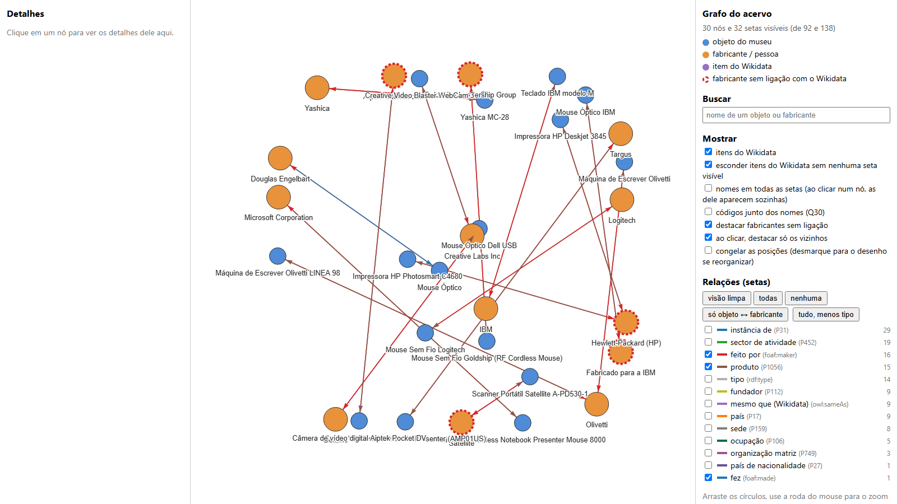
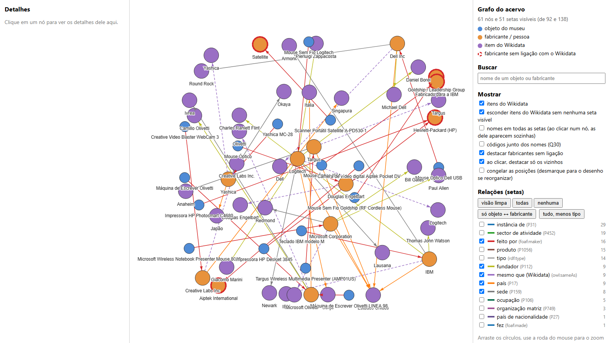
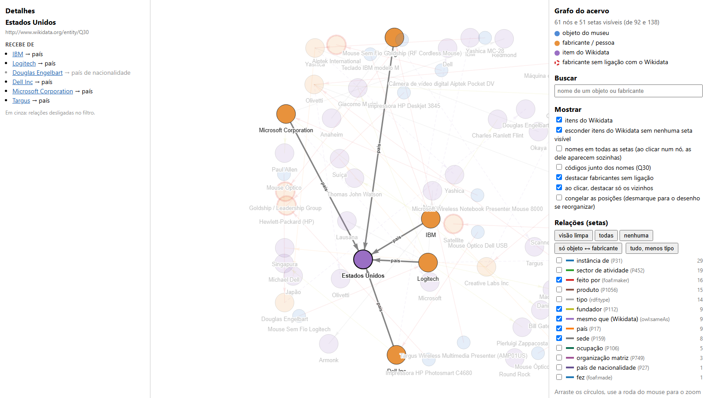
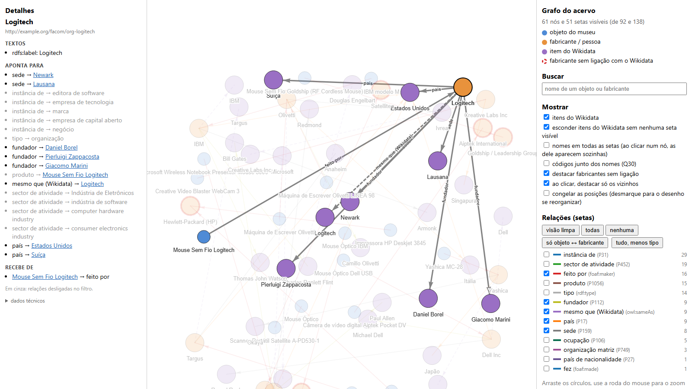

# Heritage Connector para catálogos do Tainacan

Um ambiente pronto para testar o framework [Heritage Connector](https://github.com/TheScienceMuseum/heritage-connector) (Dutia & Stack, 2021) com **qualquer CSV exportado do [Tainacan](https://tainacan.org/)**: carrega o catálogo como um grafo, liga os fabricantes ao Wikidata e permite consultar o acervo por relações que não estavam no CSV.

O teste inicial foi feito com o acervo de dispositivos de entrada e saída do [Museu FACOM](https://tainacan.facom.ufu.br/) (UFU), mas **este repositório não traz dados de nenhum museu**: você coloca o seu CSV na pasta `bruto/` e o sistema gera o resto.

> Projeto de estudo. Não é oficial e não tem relação com o Science Museum Group nem com o Museu FACOM.

## O que o sistema faz

No CSV, o cadastro diz apenas "Autoria: Logitech". Depois de ligar o fabricante ao Wikidata, o grafo passa a saber que a Logitech é uma empresa, de qual país, onde fica a sede e quem fundou. Isso permite perguntas como "quais objetos do acervo foram feitos por empresas dos Estados Unidos?", que o CSV sozinho não responde.

Exemplo, com o teste do Museu FACOM:

| Antes: só o que estava no CSV | Depois: com as ligações ao Wikidata |
|---|---|
|  |  |
| Azul: objeto. Laranja: fabricante. Borda vermelha tracejada: fabricante sem ligação com o Wikidata. | Roxo: itens do Wikidata (países, cidades, fundadores) trazidos pela ligação `owl:sameAs`. |

(Os prints são de uma rodada anterior, com 16 itens. Mostram só nomes de objetos e fabricantes.)

Resultado da rodada mais recente do teste, com 20 itens:

| Etapa | Resultado |
|---|---|
| Carga no Elasticsearch | 38 documentos: 20 objetos, 17 organizações, 1 pessoa |
| Ligação com o Wikidata (`owl:sameAs`) | 11 dos 18 fabricantes |
| Grafo exportado (`grafo_framework.ttl`) | 337 triplas |
| Consulta "objetos de empresas dos EUA" | 5 objetos: Dell, IBM, Logitech, Microsoft e Targus |

Ficaram sem país 9 objetos: 8 por fabricantes sem ligação com o Wikidata e o de uma pessoa (o Wikidata usa cidadania, não país). As ligações são semiautomáticas: o sistema sugere candidatos e a escolha é sua.

## Como funciona

```
CSV do Tainacan ──limpeza/limpeza_museu_facom.ipynb──> data/*.csv ──facom_loader.py──> Elasticsearch
                                                                │
                       data/sameas.csv (fabricante = item do Wikidata, escolha manual)
                                                                │
                buscar_propriedades.py (país, sede, fundador...)│
                                                                ▼
                  es_para_fuseki.py ──> Fuseki (consultas SPARQL)
                  es_para_ttl.py   ──> grafo_framework.ttl (o mesmo grafo, em arquivo)
                  grafo_html.py    ──> grafo.html (o grafo desenhado)
```

- **O framework** guarda cada registro no Elasticsearch como JSON-LD e converte para RDF com `es_to_rdflib_graph`. O resultado final do framework é o **grafo RDF**: no Fuseki (para consultar) e, com `es_para_ttl.py`, em arquivo (`.ttl`), como o `smg_jobs/es_to_csv.py` do projeto original faz para o museu SMG.
- **Docker** isola o ambiente: o framework é de 2021 e só funciona com bibliotecas antigas (Python 3.8).
- **`config/`** diz *onde* estão as coisas (`config.ini`) e *o que* cada coluna significa (`field_mapping.py`).

## Como usar com o seu CSV

Precisa de Docker Desktop (com cerca de 4 GB de RAM livres), Git e, para o notebook de limpeza, VS Code com as extensões Python e Jupyter. No Windows, use o Git Bash.

```bash
git clone https://github.com/andrenc1/heritage-facom-demo.git
cd heritage-facom-demo

# 1. Configuração local: copie o modelo e troque o contato.
#    O Wikidata pede identificação de quem faz consultas automáticas.
cp config/config.sample.ini config/config.ini
#    edite config/config.ini: CUSTOM_USER_AGENT = NomeDoProjeto (seu-email@exemplo.com)

# 2. Sobe Elasticsearch, Fuseki e o app (a primeira vez demora alguns minutos)
docker compose up -d --build
docker compose ps        # os 3 serviços devem estar "running"
```

**3. Seu CSV.** Exporte o CSV do Tainacan e abra o notebook `limpeza/limpeza_museu_facom.ipynb` no VS Code (kernel do `.venv`, com `pandas` e `ipykernel` instalados). Ao rodar a primeira célula, uma janela deixa você escolher o arquivo. O notebook copia o CSV para `bruto/` e grava 3 tabelas limpas em `data/` (`objects.csv`, `organisations.csv`, `object_maker.csv`); as anteriores vão para `data/anterior/`.

**4. Ligações com o Wikidata.** Procure candidatos para os fabricantes novos e escolha à mão:

```bash
docker compose exec app python scripts/pipeline/buscar_candidatos.py
```

Ele grava os candidatos em `resultados/pipeline/apoio/sameas_candidatos.csv` e cria o modelo `data/sameas.csv` (se ainda não existir). Preencha a coluna `wikidata_id` (`Q...`); deixe em branco quando não achar ou não tiver certeza. Se o `sameas.csv` já existe, ele **não é alterado**: acrescente os fabricantes novos à mão.

**5. Pipeline**, um passo por vez e nesta ordem:

```bash
docker compose exec app python scripts/pipeline/facom_loader.py          # carrega no Elasticsearch
docker compose exec app python scripts/pipeline/buscar_propriedades.py   # traz país, sede... do Wikidata
docker compose exec app python scripts/pipeline/es_para_fuseki.py        # copia para o Fuseki e consulta
docker compose exec app python scripts/pipeline/es_para_ttl.py           # (opcional) salva o grafo em .ttl
docker compose exec app python scripts/pipeline/grafo_html.py            # (opcional) gera o grafo desenhado
```

O `facom_loader.py` apaga e recria o índice a cada execução; por isso, depois de mexer no `data/sameas.csv` ou em qualquer tabela, rode os passos de novo, na mesma ordem.

### Ver o resultado

- Registros em JSON: <http://localhost:9200/heritageconnector_test/_search?pretty>
- Consultas SPARQL: <http://localhost:3030> (dataset `heritage-connector`, aba "query")
- Grafo desenhado: abra `resultados/pipeline/final/grafo.html` no navegador
- Grafo em arquivo: `resultados/pipeline/final/grafo_framework.ttl`

Exemplo de consulta, "objetos de empresas dos Estados Unidos":

```sparql
PREFIX rdfs: <http://www.w3.org/2000/01/rdf-schema#>
PREFIX foaf: <http://xmlns.com/foaf/0.1/>
PREFIX wdt:  <http://www.wikidata.org/prop/direct/>
PREFIX wd:   <http://www.wikidata.org/entity/>

SELECT ?objeto ?fabricante WHERE {
  ?o foaf:maker ?f .
  ?f wdt:P17 wd:Q30 .          # país = Estados Unidos
  ?o rdfs:label ?objeto .
  ?f rdfs:label ?fabricante .
}
```

"Estados Unidos" nunca esteve no CSV. A resposta vem do caminho objeto → fabricante → país, possível só por causa da ligação com o Wikidata:



Para desligar: `docker compose down` (mantém os dados) ou `bash reset.sh` (apaga os dados do Elasticsearch e do Fuseki; os arquivos da pasta ficam).

## RDF com todos os campos do CSV

O pipeline acima usa só os campos mapeados em `facom_loader.py`. Para um RDF que leve **todos os campos do catálogo** (os campos internos ficam de fora), há dois scripts independentes do pipeline, que não usam Elasticsearch nem Fuseki:

```bash
docker compose exec app python scripts/rdf/csv_para_rdf.py    # bruto/*.csv -> resultados/rdf/acervo_completo.ttl
docker compose exec app python scripts/rdf/ttl_para_html.py   # página para explorar o .ttl
```

A tabela `CAMPOS` no começo do `csv_para_rdf.py` diz, para cada coluna, qual propriedade RDF usar e se ela é publicada. Colunas do CSV que não estão na tabela são avisadas no terminal e ignoradas: ao testar com outro CSV, inclua-as lá.

## Visualização do grafo

`scripts/pipeline/grafo_html.py` gera uma página interativa com o grafo do Fuseki:

- círculos azuis são objetos, laranjas são fabricantes, roxos são itens do Wikidata;
- fabricantes **sem ligação** com o Wikidata têm borda vermelha tracejada;
- filtros por tipo de relação (país, sede, fundador, tipo...), busca por nome e destaque dos vizinhos de um nó;
- o painel da esquerda mostra os detalhes do nó clicado, com links para os nós vizinhos.

A tela começa com uma visão limpa (feito por, mesmo que, país, sede e fundador). O script consulta ao Wikidata os nomes dos códigos (Q30 → Estados Unidos) e guarda em `resultados/pipeline/apoio/wikidata_nomes.json`. Abaixo, a Logitech: do CSV veio só o nome e o objeto que ela fez; o resto (país, sede, fundadores) veio do Wikidata.



## Estrutura

```
heritage-facom-demo/
├── Dockerfile, docker-compose.yml   ambiente: Python 3.8, framework em versão fixa, 3 serviços
├── reset.sh                         apaga os dados do Elasticsearch e do Fuseki
├── config/
│   ├── config.sample.ini            modelo de configuração (copie para config.ini)
│   └── field_mapping.py             o que cada coluna significa (modelo do framework, sem alteração)
├── limpeza/
│   └── limpeza_museu_facom.ipynb    notebook (VS Code): CSV do Tainacan -> tabelas limpas em data/
├── scripts/
│   ├── pipeline/                    o pipeline do framework (rodam no container, nesta ordem)
│   └── rdf/                         RDF com todos os campos do CSV, independente do pipeline
├── docs/img/                        prints do grafo usados neste README
├── bruto/        (local)            o CSV original do Tainacan: não vai para o GitHub
├── data/         (local)            tabelas limpas + sameas.csv: não vai para o GitHub
└── resultados/   (local)            o que os scripts geram: não vai para o GitHub
    ├── pipeline/final/              o que o pipeline entrega: grafo.html, grafo_framework.ttl, wikidata_propriedades.csv
    ├── pipeline/apoio/              arquivos de apoio: sameas_candidatos.csv, wikidata_nomes.json
    └── rdf/                         acervo_completo.ttl, .html e campos_propostos.csv
```

Pipeline (`scripts/pipeline/`):

| Script | Para que serve |
|---|---|
| `buscar_candidatos.py` | (antes de tudo) procura candidatos no Wikidata para cada fabricante; cria o modelo de `data/sameas.csv` |
| `facom_loader.py` | Aplica o framework às tabelas de `data/` e grava no Elasticsearch |
| `buscar_propriedades.py` | Traz do Wikidata país, sede, fundador etc. (versão simplificada) |
| `es_para_fuseki.py` | Copia o grafo para o Fuseki e roda 5 consultas SPARQL |
| `es_para_ttl.py` | Exporta o mesmo grafo para um arquivo Turtle |
| `grafo_html.py` | Desenha o grafo em `resultados/pipeline/final/grafo.html` |

O que o pipeline entrega no final:

| Resultado | Onde fica | O que é |
|---|---|---|
| Registros do catálogo | Elasticsearch (`localhost:9200`) | um documento JSON-LD por objeto, organização e pessoa |
| Grafo com as ligações | Fuseki (`localhost:3030`) | triplas consultáveis por SPARQL |
| `grafo_framework.ttl` | `resultados/pipeline/final/` | o grafo do framework em RDF (Turtle) |
| `grafo.html` | `resultados/pipeline/final/` | o grafo desenhado, para abrir no navegador |
| `wikidata_propriedades.csv` | `resultados/pipeline/final/` | o que veio do Wikidata (país, sede, fundador...) em tabela |

Em `resultados/pipeline/apoio/` ficam só arquivos de apoio: `sameas_candidatos.csv` (candidatos para você escolher à mão) e `wikidata_nomes.json` (guarda os nomes dos códigos Q para não consultar de novo). O Elasticsearch e o Fuseki guardam os dados em volumes do Docker, que o `reset.sh` apaga.

RDF com todos os campos (`scripts/rdf/`):

| Script | Para que serve |
|---|---|
| `csv_para_rdf.py` | Lê o CSV de `bruto/` e gera `resultados/rdf/acervo_completo.ttl` com os campos do catálogo (os internos ficam de fora) e `campos_propostos.csv` |
| `ttl_para_html.py` | Gera `resultados/rdf/acervo_completo.html`, uma página para explorar o `.ttl` |

## Os dados

**Nenhum dado de museu está neste repositório.** `bruto/`, `data/` e `resultados/` ficam só na sua máquina (estão no `.gitignore`). O catálogo é de quem o criou, e o CSV exportado do Tainacan costuma trazer campos internos (responsáveis, localização, histórico de edição). Antes de publicar qualquer saída, confira a licença e o que o museu autoriza.

O notebook de limpeza espera as colunas padrão do Tainacan usadas no teste: `special_item_id`, `Título`, `Descrição`, `Código do inventário`, `Categoria do acervo`, `Termo`, `Data Atribuída`, `Origem`, `Modo de aquisição`, `Autoria` e `public_url`. Se o seu CSV tiver nomes diferentes, ajuste a célula "Montar a tabela de objetos". Ele gera:

| Arquivo | Colunas | Conteúdo |
|---|---|---|
| `objects.csv` | `id, label, description, inventory_code, category, term, date_attributed, origin, acquisition_mode, url` | um registro por objeto; `id` = `obj-` + o `special_item_id` do Tainacan |
| `organisations.csv` | `id, label` | um registro por fabricante (coluna *Autoria*); `id` = `org-` + nome em minúsculas, sem acento nem espaço (`org-dell-inc`) |
| `object_maker.csv` | `object_id, org_id` | liga cada objeto ao fabricante |

O quarto arquivo, `sameas.csv` (`internal_id, nome_no_museu, wikidata_id`), é preenchido à mão a partir dos candidatos.

Regras de limpeza do notebook: "sem informação" (`s/r`, `-`, `s`, vazio) vira vazio de verdade; espaços e pontos finais soltos saem. Dois dicionários, `CORRIGIR_FABRICANTE` e `CORRIGIR_CATEGORIA`, aceitam correções manuais (no teste, `Dell lnc` virou `Dell Inc`). "Fabricado para a IBM" **não** deve ser unido à IBM sem conferir: "fabricado para" indica quem encomendou, não quem fabricou.

## Limites

- Os testes foram feitos com uma única coleção pequena.
- A ligação com o Wikidata é semiautomática: os candidatos vêm da API do Wikidata e a escolha é manual. O classificador automático do artigo precisa de um índice local do Wikidata (o dump completo) e de exemplos de treino já ligados; não foi testado.
- O reconhecimento de nomes em textos (NER) não foi testado: o modelo é em inglês e as descrições estão em português.
- Os endereços dos registros (`http://example.org/facom/...`) são provisórios.
- `buscar_candidatos.py`, `buscar_propriedades.py`, `es_para_fuseki.py`, `es_para_ttl.py` e `grafo_html.py` são versões simplificadas feitas para este teste, e não o pipeline completo do artigo.
- Não foi avaliado como devolver os dados enriquecidos para o Tainacan.

## Problemas comuns

- **`sameAs` não aparece:** o `facom_loader.py` recria o índice a cada execução. Rode o pipeline de novo, na ordem.
- **Porta em uso (9200 ou 3030):** há outra instalação rodando. Desligue-a com `docker compose down` na pasta dela.
- **Elasticsearch não sobe:** falta memória no Docker Desktop (Settings > Resources). Reserve pelo menos 4 GB.
- **Erro 429 do Wikidata:** limite de pedidos. Os scripts esperam e tentam de novo; se desistirem, espere alguns minutos.
- **"service app is not running":** rode `docker compose up -d`.
- **Notebook: `No module named 'google'`:** você abriu o notebook antigo do Colab. Use `limpeza/limpeza_museu_facom.ipynb`.

## Segurança

Este projeto é para uso **local**. O Elasticsearch roda sem segurança e o Fuseki usa a senha `admin` (`ADMIN_PASSWORD` no `docker-compose.yml`, repetida em `scripts/pipeline/es_para_fuseki.py`). Não exponha as portas 9200 e 3030 na internet nem reaproveite esse arquivo em um servidor. O `config/config.ini` tem o seu contato e não vai para o GitHub.

## Créditos

- [Heritage Connector](https://github.com/TheScienceMuseum/heritage-connector), do Science Museum Group. A versão usada está fixa no `Dockerfile`.
- Dutia, K. e Stack, J. (2021). *Heritage Connector: A Machine Learning Framework for Building Linked Open Data from Museum Collections*.
- Teste inicial com o catálogo do Museu FACOM, UFU, via [Tainacan](https://tainacan.facom.ufu.br/). Os direitos sobre os dados são do museu.
