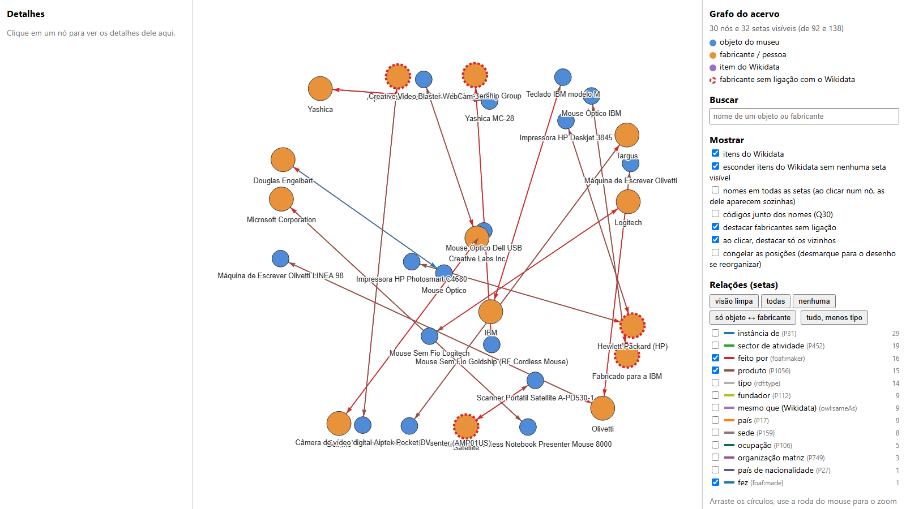
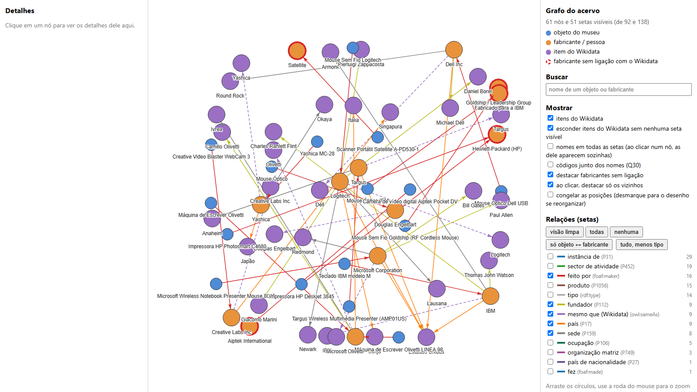
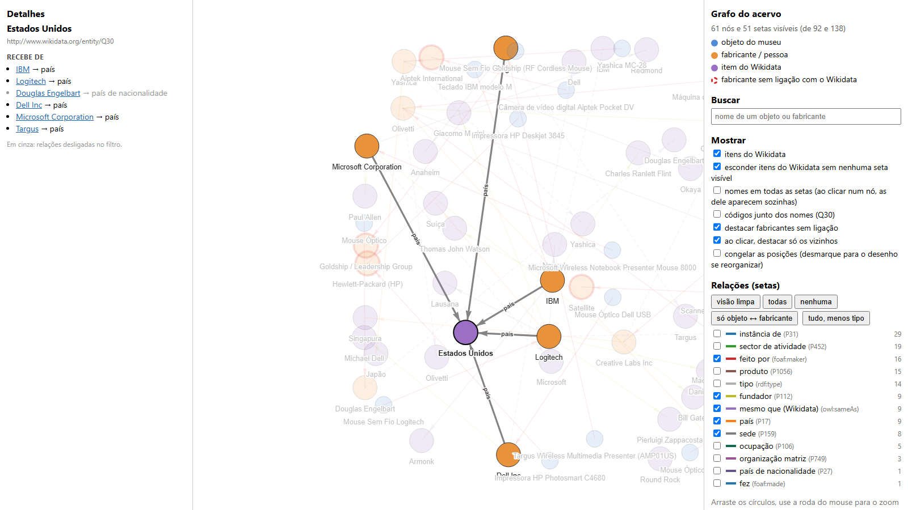
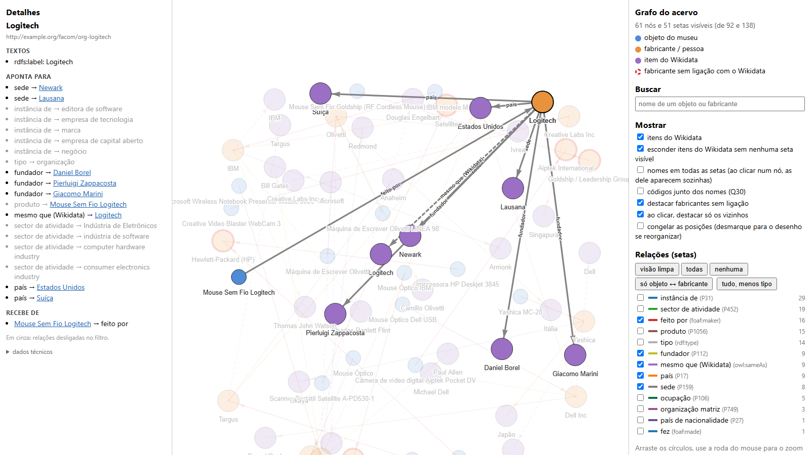

# Heritage Connector com o acervo do Museu FACOM

Teste do framework [Heritage Connector](https://github.com/TheScienceMuseum/heritage-connector) (Dutia & Stack, 2021) com dados do [Museu FACOM](https://tainacan.facom.ufu.br/) (UFU), que usa o Tainacan para catalogar o acervo.

A pergunta do teste: **o framework consegue ajudar a catalogar melhor o acervo?** A resposta aqui é uma demonstração com 16 itens de dispositivos de entrada e saída (mouses, teclados, impressoras, câmeras...): carregar o catálogo como um grafo, ligar os fabricantes ao Wikidata e consultar o acervo por relações que não estavam no CSV.

> Projeto de estudo. Não é oficial e não tem relação com o Science Museum Group nem com o Museu FACOM.

## O que o teste mostrou

No CSV, o cadastro diz apenas "Autoria: Logitech". Depois de ligar o fabricante ao Wikidata, o grafo passa a saber que a Logitech é uma empresa, de qual país, onde fica a sede e quem fundou. Isso permite perguntas como "quais objetos do acervo foram feitos por empresas dos Estados Unidos?", que o CSV sozinho não responde.

| Antes: só o que estava no CSV | Depois: com as ligações ao Wikidata |
|---|---|
|  |  |
| Azul: objeto. Laranja: fabricante. Borda vermelha tracejada: fabricante sem ligação com o Wikidata. | Roxo: itens do Wikidata (países, cidades, fundadores) trazidos pela ligação `owl:sameAs`. |

| Etapa | Resultado |
|---|---|
| Carga no Elasticsearch | 30 documentos: 16 objetos, 13 organizações, 1 pessoa |
| Ligação com o Wikidata (`owl:sameAs`) | 9 dos 14 fabricantes |
| Grafo no Fuseki | 268 triplas |
| Consulta "objetos de empresas dos EUA" | 5 objetos: Dell, IBM, Logitech, Microsoft e Targus |

Ficaram sem país 7 objetos: 6 por fabricantes sem ligação (Aiptek, Goldship, HP, Satellite e "Fabricado para a IBM") e o mouse do Douglas Engelbart (pessoa; o Wikidata usa cidadania, não país).

## Como funciona

```
CSV do Tainacan ──limpeza (feita à parte)──> data/*.csv ──facom_loader.py──> Elasticsearch
                                                                  │
                         data/sameas.csv (fabricante = item do Wikidata)
                                                                  │
                  buscar_propriedades.py (país, sede, fundador...)│
                                                                  ▼
                              es_para_fuseki.py ──> Fuseki (consultas SPARQL)
                                                                  │
                                                  grafo_html.py ──> grafo.html
```

- **Docker** isola o ambiente: o framework é de 2021 e só funciona com bibliotecas antigas (Python 3.8).
- **Elasticsearch** guarda cada registro como um documento (JSON-LD).
- **Fuseki** guarda o grafo e responde a consultas SPARQL.
- **`config/`** diz *onde* estão as coisas (`config.ini`) e *o que* cada coluna significa (`field_mapping.py`).

## Como rodar

Precisa de Docker Desktop (com cerca de 4 GB de RAM livres) e Git. O Python roda dentro do container.

```bash
git clone https://github.com/SEU-USUARIO/heritage-facom-demo.git
cd heritage-facom-demo

# 1. Dados: coloque as suas tabelas em data/ (formato na seção "Os dados", abaixo).

# 2. Configuração local: copie o modelo e troque o contato.
#    O Wikidata pede identificação de quem faz consultas automáticas.
cp config/config.sample.ini config/config.ini
#    edite config/config.ini: CUSTOM_USER_AGENT = HeritageConnectorDemo (seu-email@exemplo.com)

# 3. Sobe Elasticsearch, Fuseki e o app (a primeira vez demora alguns minutos)
docker compose up -d --build
docker compose ps        # os 3 serviços devem estar "running"

# 4. Pipeline, um passo por vez e nesta ordem
docker compose exec app python scripts/facom_loader.py          # carrega no Elasticsearch
docker compose exec app python scripts/buscar_propriedades.py   # traz país, sede... do Wikidata
docker compose exec app python scripts/es_para_fuseki.py        # copia para o Fuseki e consulta
docker compose exec app python scripts/grafo_html.py            # (opcional) gera resultados/grafo.html
```

Opcional, para procurar candidatos no Wikidata antes de preencher `data/sameas.csv`:

```bash
docker compose exec app python scripts/buscar_candidatos.py
```

Depois de mexer no `data/sameas.csv`, rode de novo os passos do pipeline na mesma ordem: o `facom_loader.py` apaga e recria o índice a cada execução.

No Windows, use o Git Bash. Se aparecerem caminhos estranhos como `C:/Program Files/Git/...`, use caminhos relativos.

### Ver o resultado

- Registros em JSON: <http://localhost:9200/heritageconnector_test/_search?pretty>
- Consultas SPARQL: <http://localhost:3030> (dataset `heritage-connector`, aba "query")
- Grafo desenhado: abra `resultados/grafo.html` no navegador

Exemplo de consulta, "objetos de empresas dos Estados Unidos":

```sparql
PREFIX rdfs: <http://www.w3.org/2000/01/rdf-schema#>
PREFIX foaf: <http://xmlns.com/foaf/0.1/>
PREFIX wdt:  <http://www.wikidata.org/prop/direct/>
PREFIX wd:   <http://www.wikidata.org/entity/>

SELECT ?objeto ?fabricante WHERE {
  ?o foaf:maker ?f .
  ?f wdt:P17 wd:Q30 .          # país = Estados Unidos
  ?o rdfs:label ?objeto .
  ?f rdfs:label ?fabricante .
}
```

"Estados Unidos" nunca esteve no CSV. A resposta vem do caminho objeto → fabricante → país, possível só por causa da ligação com o Wikidata. No grafo, é este o nó dos Estados Unidos com os fabricantes que apontam para ele:



Para desligar: `docker compose down` (mantém os dados) ou `bash reset.sh` (apaga os dados do Elasticsearch e do Fuseki).

## Visualização do grafo

`scripts/grafo_html.py` gera uma página interativa com o grafo do Fuseki:

- círculos azuis são objetos, laranjas são fabricantes, roxos são itens do Wikidata;
- fabricantes **sem ligação** com o Wikidata têm borda vermelha tracejada;
- filtros por tipo de relação (país, sede, fundador, tipo...), busca por nome e destaque dos vizinhos de um nó;
- o painel da esquerda mostra os detalhes do nó clicado, com links para os nós vizinhos.

A tela começa com uma visão limpa (feito por, mesmo que, país, sede e fundador). O script consulta ao Wikidata os nomes dos códigos (Q30 → Estados Unidos) e guarda em `resultados/wikidata_nomes.json`.

Ao clicar em um nó, só ele e os vizinhos ficam em destaque, e o painel da esquerda lista tudo o que se sabe dele. Abaixo, a Logitech: do CSV veio só o nome e o objeto que ela fez; o resto (país, sede, fundadores) veio do Wikidata.



As imagens ficam em `docs/img/` e são prints do `resultados/grafo.html`. Elas mostram só nomes de objetos e fabricantes, nenhum campo interno do catálogo.

## Estrutura

```
heritage-facom-demo/
├── Dockerfile, docker-compose.yml   ambiente: Python 3.8, framework em versão fixa, 3 serviços
├── config/
│   ├── config.sample.ini            modelo de configuração (copie para config.ini)
│   └── field_mapping.py             o que cada coluna significa (modelo do framework, sem alteração)
├── data/                            (local) tabelas limpas + sameas.csv: não vai para o GitHub
├── scripts/                         os programas em Python
├── docs/img/                        prints do grafo usados neste README
├── bruto/                           (local) CSV original do Tainacan: não vai para o GitHub
├── resultados/                      (local) o que os scripts geram: não vai para o GitHub
└── reset.sh                         apaga os dados do Elasticsearch e do Fuseki
```

| Script | Para que serve |
|---|---|
| `facom_loader.py` | Aplica o framework aos dados do museu e grava no Elasticsearch |
| `buscar_candidatos.py` | Procura candidatos no Wikidata para cada fabricante (versão simplificada) |
| `buscar_propriedades.py` | Traz do Wikidata país, sede, fundador etc. (versão simplificada) |
| `es_para_fuseki.py` | Copia o grafo para o Fuseki e roda 5 consultas SPARQL |
| `grafo_html.py` | Desenha o grafo em `resultados/grafo.html` |

## Os dados

**Os dados do museu não estão neste repositório** (`data/`, `bruto/` e `resultados/` ficam só na sua máquina). O catálogo é do Museu FACOM, os direitos são dele, e o CSV exportado do Tainacan traz campos internos (responsáveis, localização, histórico de edição). Para rodar, você precisa criar 4 arquivos CSV em `data/`, a partir do CSV exportado do seu Tainacan:

| Arquivo | Colunas | Conteúdo |
|---|---|---|
| `objects.csv` | `id, label, description, inventory_code, category, term, date_attributed, origin, acquisition_mode, url` | um registro por objeto; `id` = `obj-` + o `special_item_id` do Tainacan |
| `organisations.csv` | `id, label` | um registro por fabricante (coluna *Autoria*); `id` = `org-` + nome em minúsculas, sem acento nem espaço (`org-dell-inc`) |
| `object_maker.csv` | `object_id, org_id` | liga cada objeto ao fabricante |
| `sameas.csv` | `internal_id, nome_no_museu, wikidata_id` | escolha manual do item do Wikidata (`Q...`) de cada fabricante; pode deixar em branco quando não achar. O `buscar_candidatos.py` cria o modelo |

Regras de limpeza usadas no teste: "sem informação" (`s/r`, `-`, `s`, vazio) vira vazio de verdade; espaços e pontos finais soltos saem; `Dell lnc` virou `Dell Inc`; `Máquinas de Escrever` virou `Máquina de Escrever`. "Fabricado para a IBM" **não** foi unido à IBM de propósito: "fabricado para" indica quem encomendou, não quem fabricou.

## Limites deste teste

- Amostra pequena, de uma única coleção.
- A ligação com o Wikidata foi semiautomática: os candidatos vêm da API do Wikidata e a escolha é manual. O classificador automático do artigo precisa de um índice local do Wikidata (o dump completo) e de exemplos de treino já ligados; não foi testado.
- O reconhecimento de nomes em textos (NER) não foi testado: o modelo é em inglês e as descrições estão em português.
- Os endereços dos registros (`http://example.org/facom/...`) são provisórios.
- `buscar_candidatos.py`, `buscar_propriedades.py`, `es_para_fuseki.py` e `grafo_html.py` são versões simplificadas feitas para este teste, e não o pipeline completo do artigo.
- Não foi avaliado como devolver os dados enriquecidos para o Tainacan.

## Problemas comuns

- **`sameAs` não aparece:** o `facom_loader.py` recria o índice a cada execução. Rode o pipeline de novo, na ordem.
- **Porta em uso (9200 ou 3030):** há outra instalação rodando. Desligue-a com `docker compose down` na pasta dela.
- **Elasticsearch não sobe:** falta memória no Docker Desktop (Settings > Resources). Reserve pelo menos 4 GB.
- **Erro 429 do Wikidata:** limite de pedidos. Os scripts esperam e tentam de novo; se desistirem, espere alguns minutos.
- **"service app is not running":** rode `docker compose up -d`.

## Segurança

Este projeto é para uso **local**. O Elasticsearch roda sem segurança e o Fuseki usa a senha `admin` (`ADMIN_PASSWORD` no `docker-compose.yml`, repetida em `scripts/es_para_fuseki.py`). Não exponha as portas 9200 e 3030 na internet nem reaproveite esse arquivo em um servidor.

## Créditos

- [Heritage Connector](https://github.com/TheScienceMuseum/heritage-connector), do Science Museum Group. A versão usada está fixa no `Dockerfile`.
- Dutia, K. e Stack, J. (2021). *Heritage Connector: A Machine Learning Framework for Building Linked Open Data from Museum Collections*.
- Dados do catálogo: Museu FACOM, UFU, via [Tainacan](https://tainacan.facom.ufu.br/). Os direitos sobre os dados são do museu; confirme a licença antes de reutilizá-los.
